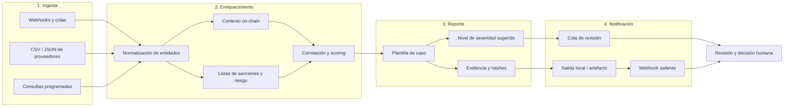

# WACB — Web3 Alert Compliance Bot

Herramienta de código abierto para la **pre-investigación y el triaje de alertas Web3**. Recibe alertas de múltiples fuentes, las enriquece con contexto on-chain y de listas de riesgo, y genera un reporte listo para revisión humana en minutos, no en días.

> **Estado:** alpha. Adecuada para evaluación, laboratorios y equipos de compliance que quieran automatizar el trabajo repetitivo del triaje. No es un producto de producción ni un sustituto de un proveedor de análisis de blockchain.

---

## El problema de negocio

### La ventana crítica de 48 horas

En el ecosistema Web3, una alerta de riesgo pierde valor muy rápido. Los fondos pueden moverse entre decenas de direcciones en cuestión de horas, pasar por *mixers*, *bridges* o *exchanges* con procesos KYC distintos, y salir de la jurisdicción relevante antes de que un analista termine de abrir el caso.

Las obligaciones de reporte y las políticas internas de muchas entidades (procedimientos AML/CFT, requisitos de la *Travel Rule*, gestión de sanciones) presionan además con plazos operativos que, en la práctica, se concentran en **las primeras 48 horas** desde la detección. Pasado ese margen:

- La trazabilidad se degrada y el costo de reconstruir el flujo aumenta.
- Se pierden oportunidades de bloqueo, congelamiento o escalado oportuno.
- Aumenta el riesgo regulatorio y reputacional por respuestas tardías.
- El equipo pierde contexto sobre por qué se generó la alerta.

### El triaje manual no escala

Hoy el triaje suele ser un proceso artesanal:

1. Un analista recibe una alerta por correo, Slack o un panel.
2. Abre manualmente varios exploradores de bloques, listas de sanciones, registros de *mixers* y bases internas.
3. Copia y pega direcciones, hashes y montos en una hoja de cálculo.
4. Escribe un resumen desde cero, a menudo sin plantilla ni criterios homogéneos.
5. Decide si escala, cierra o solicita más información.

Este flujo tiene tres problemas estructurales: **latencia** (cada caso consume entre 30 y 90 minutos), **inconsistencia** (dos analistas llegan a conclusiones distintas con la misma evidencia) y **fatiga de alertas** (el volumen de falsos positivos hace que las señales reales se entierren).

WACB ataca la parte mecánica de ese trabajo: recolecta, normaliza y enriquece la evidencia, y entrega un borrador de reporte estructurado. **La decisión final sigue siendo humana.**

---

## Cómo funciona



Cada etapa es idempotente y deja trazas auditables: qué se ingirió, qué se consultó, qué reglas se aplicaron y qué severidad se sugirió. El reporte generado es un **borrador de trabajo**, no un dictamen.

### Etapas

| Etapa | Qué hace | Resultado |
| --- | --- | --- |
| Ingesta | Recibe alertas de webhooks, ficheros o consultas programadas y valida el esquema. | Alerta normalizada y encolada |
| Enriquecimiento | Resuelve direcciones, consulta fuentes de riesgo, correlaciona entidades y calcula un score. | Evidencia consolidada con procedencia |
| Reporte | Rellena una plantilla de caso con hechos, evidencia, huecos de información y severidad sugerida. | Reporte en Markdown/JSON |
| Notificación | Publica el reporte como artefacto, lo encola para revisión o lo envía por webhook. | Caso listo para un analista |

---

## Requisitos

- **Docker** y **Docker Compose** (recomendado), o
- **Python 3.11+** y **GNU Make** para ejecución local sin contenedores
- Sin claves de API obligatorias para la demo: los datos de ejemplo y las fuentes simuladas funcionan offline

> En Windows, ejecuta los comandos desde WSL2, Git Bash o un entorno con `make` disponible.

---

## Inicio rápido

```bash
git clone https://github.com/<tu-organizacion>/wacb.git
cd wacb
cp .env.example .env    # opcional: ajusta configuración local
make run-demo
```

### `make run-demo`

Levanta el pipeline completo con un conjunto de alertas de ejemplo y fuentes simuladas. No requiere red ni credenciales.

Qué hace:

1. Construye la imagen o prepara el entorno virtual.
2. Carga las alertas de `demo/fixtures/` en la cola de ingesta.
3. Ejecuta ingesta, enriquecimiento y generación de reportes de extremo a extremo.
4. Deja los resultados en `out/demo/` (reportes en Markdown y JSON, más un resumen en consola).
5. Termina con código de salida `0` si todos los casos se procesaron.

```bash
make run-demo

# Salida esperada (resumen)
# Casos procesados: 12
# Severidad sugerida: 2 alta, 5 media, 5 baja
# Reportes: out/demo/reports/
```

Puedes inspeccionar un reporte generado:

```bash
cat out/demo/reports/case-0001.md
```

### `make test`

Ejecuta la suite de pruebas: unitarias, de contrato y de integración con *fixtures* locales. No realiza llamadas de red ni consume cuotas de proveedores.

```bash
make test
```

Cubre, entre otros:

- Validación y normalización de alertas de entrada.
- Reglas de enriquecimiento y cálculo de score con datos simulados.
- Renderizado de la plantilla de reporte.
- Idempotencia del pipeline y manejo de errores por etapa.
- Contratos de salida (JSON estable para consumidores downstream).

Para un subconjunto rápido durante el desarrollo:

```bash
make test-unit
```

---

## Configuración

La configuración se lee de variables de entorno (`.env` en local). No se requieren credenciales para la demo.

| Variable | Descripción | Por defecto |
| --- | --- | --- |
| `WACB_ENV` | Entorno de ejecución (`dev`, `demo`, `test`) | `dev` |
| `WACB_INPUT_DIR` | Directorio de entrada para ingesta basada en ficheros | `demo/fixtures` |
| `WACB_OUTPUT_DIR` | Directorio de reportes y artefactos | `out` |
| `WACB_PROVIDER_MODE` | `mock` para fuentes simuladas, `live` para integraciones reales | `mock` |
| `WACB_LOG_LEVEL` | Nivel de log (`debug`, `info`, `warn`, `error`) | `info` |

Nunca incluyas claves de API reales en el repositorio. Usa `.env` local o el gestor de secretos de tu organización.

---

## Estructura del repositorio

```text
.
├── demo/                 # Datos y escenarios de demostración
│   └── fixtures/         # Alertas de ejemplo
├── docs/                 # Documentación de arquitectura y criterios de triaje
├── src/                  # Código fuente
│   ├── ingest/           # Conectores de entrada
│   ├── enrich/           # Normalización, fuentes y scoring
│   ├── report/           # Plantillas y renderizado
│   └── notify/           # Salidas y webhooks
├── tests/                # Pruebas unitarias y de integración
├── Makefile
└── README.md
```

---

## Aviso legal

**WACB es una herramienta de apoyo a la pre-investigación y al triaje. No es un producto de análisis forense de blockchain ni una solución de cumplimiento llave en mano.**

- **No reemplaza a Chainalysis, Elliptic ni a ningún otro proveedor de análisis de blockchain.** WACB no pretende sustituir sus capacidades de atribución, clustering, monitoreo continuo ni cobertura de datos. Si tu organización depende de esos proveedores para decisiones regulatorias, WACB debe usarse como complemento, nunca como sustituto.
- **Requiere decisión humana.** Las severidades, scores y reportes generados son sugerencias automatizadas basadas en reglas y datos disponibles. Ningún resultado debe interpretarse como una conclusión definitiva. Un analista cualificado debe revisar la evidencia, validar las fuentes y decidir si escala, cierra o reporta el caso.
- **No constituye asesoramiento legal, financiero ni regulatorio.** La herramienta no presenta reportes a autoridades ni cumple por sí misma obligaciones AML/CFT, de sanciones o de la *Travel Rule*.
- **Los datos pueden ser incompletos o estar desactualizados.** La calidad del resultado depende de las fuentes configuradas y de su latencia. Verifica siempre contra la fuente primaria.
- **Sin garantías.** El software se distribuye "tal cual", sin garantía de exactitud, disponibilidad o idoneidad para un fin concreto. El uso y las decisiones derivadas son responsabilidad exclusiva de la entidad usuaria.

---

## Extensiones futuras

Estas capacidades están en el roadmap y **no forman parte de la versión actual**:

- **Notificaciones vía WhatsApp Cloud API.** Envío de resúmenes de caso y solicitudes de decisión a analistas mediante la API oficial de Meta, con plantillas aprobadas y trazabilidad de entrega.
- **Enrutamiento por severidad.** Distribución automática de casos según el nivel sugerido: alertas altas a revisión inmediata, medias a cola estándar y bajas a muestreo o cierre asistido, con escalado y *timeouts* configurables.
- **Conectores adicionales** para proveedores de riesgo y exploradores, con interfaz de plugin.
- **Panel de revisión** con historial de decisiones y métricas de tiempo de triaje.
- **Exportación de casos** a formatos compatibles con flujos internos de compliance.

Las contribuciones en estas direcciones son bienvenidas; abre un *issue* para discutir el diseño antes de enviar un *pull request* grande.

---

## Contribuir

1. Abre un *issue* describiendo el problema o la propuesta.
2. Crea una rama desde `main`.
3. Añade pruebas para los cambios de comportamiento.
4. Ejecuta `make test` y asegúrate de que pasa.
5. Envía un *pull request* con una descripción clara del cambio y su motivación.

---

## Licencia

MIT. Consulta el archivo `LICENSE` para el texto completo.
