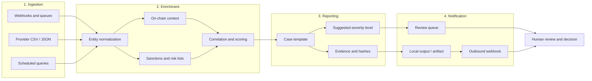

# WACB — Web3 Alert Compliance Bot

An open-source tool for the **pre-investigation and triage of Web3 alerts**. It ingests alerts from multiple sources, enriches them with on-chain and risk-list context, and produces a report ready for human review in minutes rather than days.

> **Status:** alpha. Suitable for evaluation, labs, and compliance teams looking to automate the repetitive work of triage. It is not a production product and not a substitute for a blockchain analytics provider.

---

## The business problem

### The critical 48-hour window

In the Web3 ecosystem, a risk alert loses value very quickly. Funds can move across dozens of addresses within hours, pass through *mixers*, *bridges*, or *exchanges* with different KYC processes, and leave the relevant jurisdiction before an analyst has even finished opening the case.

Reporting obligations and the internal policies of many entities (AML/CFT procedures, *Travel Rule* requirements, sanctions management) also impose operational deadlines that, in practice, cluster around **the first 48 hours** after detection. Once that window closes:

- Traceability degrades and the cost of reconstructing the flow increases.
- Opportunities for blocking, freezing, or timely escalation are lost.
- Regulatory and reputational risk grows due to delayed responses.
- The team loses context about why the alert was generated in the first place.

### Manual triage does not scale

Today, triage is typically a handcrafted process:

1. An analyst receives an alert by email, Slack, or a dashboard.
2. They manually open several block explorers, sanctions lists, *mixer* registries, and internal databases.
3. They copy and paste addresses, hashes, and amounts into a spreadsheet.
4. They write a summary from scratch, often without a template or consistent criteria.
5. They decide whether to escalate, close, or request more information.

This workflow has three structural problems: **latency** (each case takes 30 to 90 minutes), **inconsistency** (two analysts reach different conclusions from the same evidence), and **alert fatigue** (the volume of false positives buries the real signals).

WACB targets the mechanical part of that work: it collects, normalizes, and enriches the evidence, then delivers a structured draft report. **The final decision remains human.**

---

## How it works



Each stage is idempotent and leaves auditable traces: what was ingested, what was queried, which rules were applied, and which severity was suggested. The generated report is a **working draft**, not a determination.

### Stages

| Stage | What it does | Output |
| --- | --- | --- |
| Ingestion | Receives alerts from webhooks, files, or scheduled queries and validates the schema. | Normalized, queued alert |
| Enrichment | Resolves addresses, queries risk sources, correlates entities, and computes a score. | Consolidated evidence with provenance |
| Reporting | Populates a case template with facts, evidence, information gaps, and suggested severity. | Markdown/JSON report |
| Notification | Publishes the report as an artifact, queues it for review, or sends it via webhook. | Case ready for an analyst |

---

## Requirements

- **Docker** and **Docker Compose** (recommended), or
- **Python 3.11+** and **GNU Make** for local execution without containers
- No mandatory API keys for the demo: sample data and mocked sources work offline

> On Windows, run the commands from WSL2, Git Bash, or an environment with `make` available.

---

## Quick start

```bash
git clone https://github.com/<your-organization>/wacb.git
cd wacb
cp .env.example .env    # optional: adjust local configuration
make run-demo
```

### `make run-demo`

Spins up the full pipeline against a set of sample alerts and mocked sources. No network access or credentials required.

What it does:

1. Builds the image or prepares the virtual environment.
2. Loads the alerts from `demo/fixtures/` into the ingestion queue.
3. Runs ingestion, enrichment, and report generation end to end.
4. Writes the results to `out/demo/` (Markdown and JSON reports, plus a console summary).
5. Exits with code `0` if every case was processed.

```bash
make run-demo

# Expected output (summary)
# Cases processed: 12
# Suggested severity: 2 high, 5 medium, 5 low
# Reports: out/demo/reports/
```

You can inspect a generated report:

```bash
cat out/demo/reports/case-0001.md
```

### `make test`

Runs the test suite: unit, contract, and integration tests against local *fixtures*. It performs no network calls and consumes no provider quotas.

```bash
make test
```

It covers, among other things:

- Validation and normalization of incoming alerts.
- Enrichment rules and score computation with mocked data.
- Rendering of the report template.
- Pipeline idempotency and per-stage error handling.
- Output contracts (stable JSON for downstream consumers).

For a quick subset during development:

```bash
make test-unit
```

---

## Configuration

Configuration is read from environment variables (`.env` locally). No credentials are required for the demo.

| Variable | Description | Default |
| --- | --- | --- |
| `WACB_ENV` | Runtime environment (`dev`, `demo`, `test`) | `dev` |
| `WACB_INPUT_DIR` | Input directory for file-based ingestion | `demo/fixtures` |
| `WACB_OUTPUT_DIR` | Directory for reports and artifacts | `out` |
| `WACB_PROVIDER_MODE` | `mock` for simulated sources, `live` for real integrations | `mock` |
| `WACB_LOG_LEVEL` | Log level (`debug`, `info`, `warn`, `error`) | `info` |

Never commit real API keys to the repository. Use a local `.env` file or your organization's secrets manager.

---

## Repository structure

```text
.
├── demo/                 # Demo data and scenarios
│   └── fixtures/         # Sample alerts
├── docs/                 # Architecture documentation and triage criteria
├── src/                  # Source code
│   ├── ingest/           # Inbound connectors
│   ├── enrich/           # Normalization, sources, and scoring
│   ├── report/           # Templates and rendering
│   └── notify/           # Outputs and webhooks
├── tests/                # Unit and integration tests
├── Makefile
└── README.md
```

---

## Legal notice

**WACB is a pre-investigation and triage support tool. It is not a blockchain forensics product and not a turnkey compliance solution.**

- **It does not replace Chainalysis, Elliptic, or any other blockchain analytics provider.** WACB does not aim to substitute for their attribution, clustering, continuous monitoring, or data coverage capabilities. If your organization relies on those providers for regulatory decisions, WACB must be used as a complement, never as a replacement.
- **It requires human judgment.** The severities, scores, and reports generated are automated suggestions based on rules and available data. No result should be interpreted as a definitive conclusion. A qualified analyst must review the evidence, validate the sources, and decide whether to escalate, close, or report the case.
- **It does not constitute legal, financial, or regulatory advice.** The tool does not file reports with authorities and does not by itself satisfy AML/CFT, sanctions, or *Travel Rule* obligations.
- **Data may be incomplete or out of date.** The quality of the output depends on the configured sources and their latency. Always verify against the primary source.
- **No warranties.** The software is distributed "as is", without warranty of accuracy, availability, or fitness for a particular purpose. Use of the software and any decisions derived from it are the sole responsibility of the user entity.

---

## Future extensions

These capabilities are on the roadmap and are **not part of the current version**:

- **WhatsApp Cloud API notifications.** Sending case summaries and decision requests to analysts through Meta's official API, with approved templates and delivery traceability.
- **Severity-based routing.** Automatic distribution of cases according to the suggested level: high alerts to immediate review, medium alerts to the standard queue, and low alerts to sampling or assisted closure, with configurable escalation and *timeouts*.
- **Additional connectors** for risk providers and explorers, with a plugin interface.
- **Review dashboard** with decision history and triage time metrics.
- **Case export** to formats compatible with internal compliance workflows.

Contributions in these directions are welcome; open an *issue* to discuss the design before submitting a large *pull request*.

---

## Contributing

1. Open an *issue* describing the problem or proposal.
2. Create a branch from `main`.
3. Add tests for behavioral changes.
4. Run `make test` and make sure it passes.
5. Submit a *pull request* with a clear description of the change and its rationale.

---

## License

MIT. See the `LICENSE` file for the full text.
