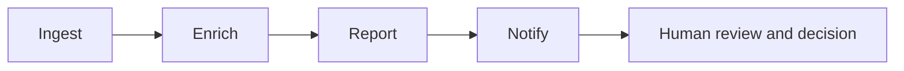

# WACB — Web3 Alert Compliance Bot

Open-source tool for **pre-investigation and triage of Web3 alerts**. It ingests alerts, enriches them with on-chain context and mock risk data, and produces a structured report ready for human review in minutes instead of days.

> **Status:** alpha. Suitable for evaluation, labs and compliance teams that want to automate the repetitive part of triage. It is not a production product nor a substitute for a blockchain analytics provider.

---

## How it works

The demo runs a four-stage pipeline:


### Demo


| Stage | What it does | Output |
| --- | --- | --- |
| Ingest | Loads and validates `data/mock_alerts.json` against the alert schema. | Normalized alerts |
| Enrichment | Adds derived context (risk band, 48 h window state, on-chain metrics) without external calls. | Alerts with an `enrichment` block |
| Reporting | Renders a Markdown dossier per alert into `output/`. | `<alert_id>.md` files |
| Notification | Sends a summary per alert to the configured Telegram chats. | Telegram messages |

The generated report is a **working draft**, not a verdict. The final decision remains human.

---

## Requirements

- **Python 3.11+** and **pip**.

No API keys are required for the demo: the sample data and the mock enrichment run offline.

---

## Quick start

```bash
git clone https://github.com/<your-org>/wacb.git
cd wacb
python -m venv .venv
# Activate the environment (Windows: .venv\Scripts\activate)
source .venv/bin/activate
pip install -r requirements.txt
cp .env.example .env   # optional: fill in Telegram credentials
python main.py demo
```

To generate the dossiers without sending notifications:

```bash
python main.py demo --skip-notify
```

### Command-line options

```bash
python main.py demo [--dataset PATH] [--output-dir PATH] [--skip-notify] [--verbose]
```

| Option | Default | Description |
| --- | --- | --- |
| `--dataset` | `data/mock_alerts.json` | Path to the mock alerts JSON file. |
| `--output-dir` | `output/` | Directory where the generated dossiers are written. |
| `--skip-notify` | off | Generate dossiers without sending Telegram notifications. |
| `--verbose` | off | Enable debug logging. |

---

## Configuration

Configuration is read from environment variables (`.env` locally). Only Telegram is required to send notifications.

| Variable | Description |
| --- | --- |
| `TELEGRAM_BOT_TOKEN` | Telegram bot token used by the notification step. |
| `TELEGRAM_CHAT_IDS` | Comma-separated list of chat ids that receive the alerts. |

Never commit real API keys. Use a local `.env` or your organization's secret manager.

---

## Repository structure

```text
.
├── main.py                     # CLI entry point (python main.py demo)
├── src/
│   ├── ingest/
│   │   └── loader.py           # Loads and validates the alerts JSON
│   ├── enrichment/
│   │   └── mock_enricher.py    # Mock enrichment (risk band, 48 h window)
│   ├── reporting/
│   │   └── dossier.py          # Markdown dossier generation
│   └── notifiers/
│       ├── base.py             # Notifier interface and DeliveryResult
│       ├── telegram.py         # TelegramNotifier
│       └── whatsapp.py         # WhatsAppNotifier (placeholder)
├── data/
│   └── mock_alerts.json        # Sample alerts for the demo
├── output/                     # Generated dossiers (gitignored)
├── tests/                      # Unit tests
├── Makefile
├── requirements.txt            # Runtime dependencies
├── requirements-dev.txt        # Development dependencies
└── .env.example
```

---

## Tests

Run the test suite with:

```bash
make test
# or
python -m pytest -q tests
```

---

## Legal notice

**WACB is a support tool for pre-investigation and triage. It is not a blockchain forensics product nor a turnkey compliance solution.**

- **It does not replace Chainalysis, Elliptic or any other blockchain analytics provider.** WACB does not claim to substitute their attribution, clustering, continuous monitoring or data coverage. If your organization depends on those providers for regulatory decisions, WACB should be used as a complement, never as a substitute.
- **Human decision is required.** Severities, scores and reports are automated suggestions based on rules and available data. No result should be interpreted as a definitive conclusion. A qualified analyst must review the evidence, validate the sources and decide whether to escalate, close or report the case.
- **It does not constitute legal, financial or regulatory advice.** The tool does not file reports to authorities nor fulfill AML/CFT, sanctions or Travel Rule obligations by itself.
- **Data may be incomplete or outdated.** Result quality depends on the configured sources and their latency. Always verify against the primary source.
- **No warranties.** The software is distributed "as is", without warranty of accuracy, availability or fitness for a particular purpose. Use and derived decisions are the sole responsibility of the user entity.

---

## Contributing

1. Open an issue describing the problem or proposal.
2. Create a branch from `main`.
3. Add tests for behavior changes.
4. Run `make test` and make sure it passes.
5. Open a pull request with a clear description of the change and its motivation.

---

## License

MIT. See the `LICENSE` file for the full text.
